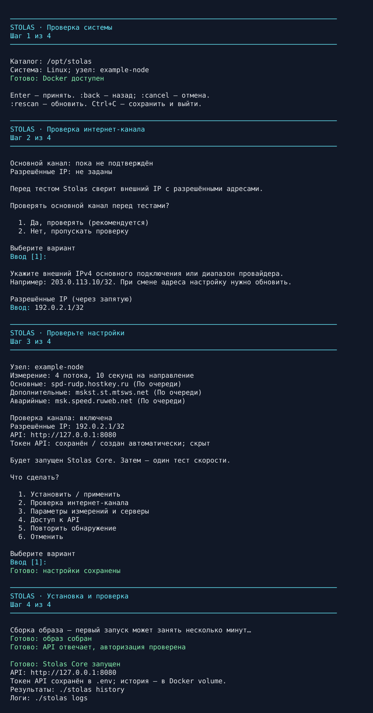

# Интерфейс Stolas

После выбора каталога обычная установка требует три ответа:
проверять ли основной канал, какой внешний IP разрешён, применить ли настройки.
Из сводки можно открыть нужный раздел и изменить параметры.
В v0.5.1 после запуска Core добавлен необязательный шаг команды в PATH
(пользовательский каталог, общесистемный каталог с подтверждением или «Позже»).
При отсутствии прямого доступа к Docker предупреждение видно до сводки,
даже если обнаружение с `sudo -n` удалось. [Подробности](INSTALLATION.md#команда-из-любого-каталога).

## Общие правила

Все Python-мастера используют `Terminal.question` и `Terminal.prompt` через
`ask`, `choice` и `select_named`. Каждый вопрос начинается с пустой строки;
пояснение передаётся через `help_text` внутри того же блока. Меню содержит
один вопрос, варианты и строку ввода. Независимые этапы используют `stage`.
Результат операции завершается перед следующим блоком вопроса.

Ширина вывода следует ширине терминала (до 80 колонок); длинные значения
переносятся, длинное значение по умолчанию выводится отдельно от ввода.
Тесты проверяют также 20, 24 и 40 колонок. Цвет не влияет на структуру.

## Полный диалог

Ниже воспроизводимый снимок основного диалога в терминале шириной 80 символов.
Docker и локальный API в UI-фикстуре симулированы. Это синтетический пример
интерфейса. CIDR и имена серверов заменены примерами для документации.
На реальной установке укажите известный внешний IP основного подключения.



Текстовая версия той же сессии:

```text

────────────────────────────────────────────────────────────────────────────────
STOLAS · Проверка системы
Шаг 1 из 4
────────────────────────────────────────────────────────────────────────────────

Каталог: /opt/stolas
Система: Linux; узел: example-node
Готово: Docker доступен

Enter — принять значение по умолчанию.

────────────────────────────────────────────────────────────────────────────────
STOLAS · Проверка интернет-канала
Шаг 2 из 4
────────────────────────────────────────────────────────────────────────────────

Основной канал: пока не подтверждён
Разрешённые IP: не заданы

Проверять основной канал перед тестами?

  1. Да, проверять (рекомендуется)
  2. Нет, пропускать проверку

Ввод [1]:
Внешний IPv4 основного подключения или диапазон провайдера.
Например: 203.0.113.10/32. При смене адреса обновите настройку.
Разрешённые IP (через запятую)
Ввод:
────────────────────────────────────────────────────────────────────────────────
STOLAS · Проверьте настройки
Шаг 3 из 4
────────────────────────────────────────────────────────────────────────────────

Узел: example-node
Измерение: 4 потока, 10 секунд на направление
Основные: primary.example.test (По очереди)
Дополнительные: additional.example.test (По очереди)
Аварийные: emergency.example.test (По очереди)

Проверка канала: включена
Разрешённые IP: 192.0.2.1/32
API: http://127.0.0.1:8080
Токен API: сохранён / создан автоматически; скрыт

Будет запущен Stolas Core.

Что сделать?

  1. Установить / применить
  2. Проверка интернет-канала
  3. Параметры измерений и серверы
  4. Доступ к API
  5. Отменить

Ввод [1]:
────────────────────────────────────────────────────────────────────────────────
STOLAS · Установка и проверка
Шаг 4 из 4
────────────────────────────────────────────────────────────────────────────────

Сборка образа — первый запуск может занять несколько минут…
Готово: Stolas Core запущен
API: http://127.0.0.1:8080
Токен API сохранён в .env; история — в Docker volume.
Результаты: ./stolas history
Логи: ./stolas logs
```

## Навигация и совместимость

Из сводки можно исправить отдельный раздел. Пункт «Отменить» отменяет
настройку до применения. Ctrl+C прерывает процесс без сохранения
неподтверждённых настроек. Повторный запуск мастера проверяет систему заново.

ANSI-акценты включаются в TTY с подходящим TERM: голубой — этап/ввод,
зелёный — успех, жёлтый — предупреждение, красный — ошибка.
`NO_COLOR`, `TERM=dumb`, отсутствие TTY/ANSI сохраняют тот же текст без цвета.
Длинные значения переносятся; ввод работает при вставке значений.

Реальный Linux PTY-тест в CI проверяет 80 колонок, ошибочный ввод,
пустые строки и ANSI. Артефакт `installer-terminal` содержит
сырой вывод реального псевдотерминала; SVG выше воспроизводится той же фикстурой.

Установка проверяет готовность контейнера и авторизацию API, без измерения скорости
и WAN-проб. Первый тест запускается отдельно командой `./stolas run`.

Блокировка установщика, приватные файлы, проверка WAN при явном измерении, nonroot-контейнер,
checksum архива, резервные копии и восстановление сохранены.
Сети Docker, firewall, proxy и сторонние контейнеры автоматически не меняются.

## Управление установленным приложением

`./stolas help` показывает команды. Настройка, обновление, диагностика,
интеграции и удаление используют те же заголовки, цвета и отдельные вопросы.

Удаление сначала показывает каталог, проект, контейнеры, образы и volume.
Далее предлагает сохранить историю, удалить всё или отменить операцию.
Сохранение истории выбрано по умолчанию; для purge нужно ввести `УДАЛИТЬ`.
В CI удаление и диагностика проверяются в настоящем PTY с ANSI и NO_COLOR.


## Активность длительных операций

Установка Docker и зависимостей, сборка, проверка конфигурации, запуск контейнера
и явное измерение показывают название этапа, результат и длительность в stderr.
В интерактивном терминале индикатор обновляется каждые 250 мс даже при молчании
подпроцесса. Для сборки показывается только безопасное название операции Docker
(RUN, COPY, загрузка контекста, экспорт), без аргументов, URL и содержимого логов.
Проценты и ETA не вычисляются. В CI и при перенаправлении stdout или stderr используются
обычные текстовые строки без перерисовки.

Вывод дочернего процесса временно хранится в приватном каталоге и удаляется после
этапа; в памяти остаётся максимум 64 KiB на поток (для JSON явного измерения —
16 MiB stdout, превышение завершает этап с ошибкой). Сырые логи не транслируются
в индикатор. При ошибке выводятся код завершения и команда для повторной сборки
с полным логом. Ctrl+C и таймаут останавливают локальную группу процессов;
удалённое выполнение в Docker может продолжиться, его состояние следует проверить.
Лимит сборки/установки Docker — 30 минут, запуска контейнера — 120 секунд,
теста — 60 минут. CLI history ждёт не более 30 секунд, run — 60 минут;
таймаут даёт код 124. Потоковая команда logs работает до прерывания.

Все вызовы Compose exec из CLI используют `--interactive=false`;
stdin закрыт. Машинные run/history сохраняют JSON в stdout.
